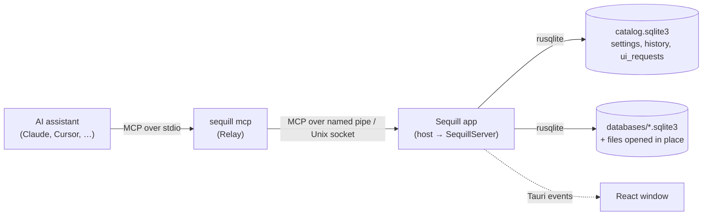
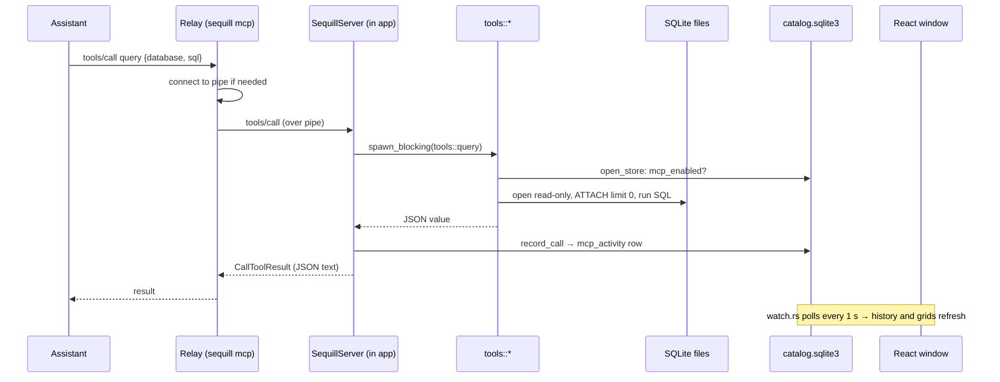
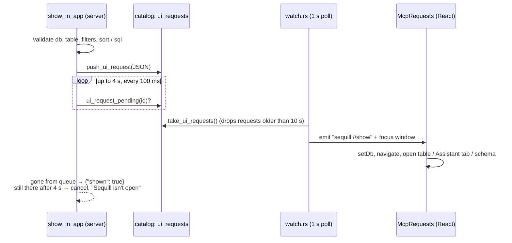

# How MCP works in Sequill

This guide explains how Sequill exposes its SQLite databases to AI assistants over the
[Model Context Protocol](https://modelcontextprotocol.io) (MCP): the processes involved, how a
tool call travels, how permissions are enforced, how the UI shows what assistants did, and how to
add or change a tool. For end-user setup, see the [MCP server section of the README](../README.md#mcp-server).

## Contents

1. [The big picture](#1-the-big-picture)
2. [Where the code lives](#2-where-the-code-lives)
3. [Process model: app host and relay](#3-process-model-app-host-and-relay)
4. [The local pipe](#4-the-local-pipe)
5. [Life of a tool call](#5-life-of-a-tool-call)
6. [Permissions: the two switches](#6-permissions-the-two-switches)
7. [Opening databases safely](#7-opening-databases-safely)
8. [The tools](#8-the-tools)
9. [Call history](#9-call-history)
10. [`show_in_app`: assistant → window](#10-show_in_app-assistant--window)
11. [Live refresh after an assistant writes](#11-live-refresh-after-an-assistant-writes)
12. [The frontend](#12-the-frontend)
13. [Connecting an assistant](#13-connecting-an-assistant)
14. [Adding or changing a tool](#14-adding-or-changing-a-tool)
15. [Running and testing](#15-running-and-testing)
16. [Troubleshooting](#16-troubleshooting)

---

## 1. The big picture

Sequill ships one executable, `sequill`. Run with no arguments it is the desktop app; run as
`sequill mcp` it is a small MCP server that an assistant (Claude Desktop, Claude Code, Cursor, …)
starts over stdio.

The key design decision: **only the running app ever opens the databases.** `sequill mcp` is a
thin _relay_ that forwards each MCP call over a local pipe to the app, and the app runs the tool.



Why relay instead of opening the files directly?

- **One source of truth.** The assistant sees exactly the same database list and files as the
  window, including files the user opened in place from anywhere on disk.
- **Packaged clients on Windows.** Apps like Claude Desktop can run inside an MSIX package with a
  virtualised `%APPDATA%`. A process they start would see a private copy of the data folder. The
  pipe sidesteps that, because the app (not the relay) touches the folder.
- **Works while closed.** If the app isn't running, the relay runs the call itself with its own
  `SequillServer` on the data folder (same tools, switches and history); the app's watcher shows
  the changes once it opens, and the next call goes to the app again. Inside an MSIX package
  (`in_app_package()` in `relay.rs`, via `GetCurrentPackageFullName`) that would write to the
  private copy, so there each call answers "Sequill isn't open…" instead, and the next call after
  the user opens it just works — no assistant restart.

## 2. Where the code lives

| Path                                                                                                    | Role                                                                                           |
| ------------------------------------------------------------------------------------------------------- | ---------------------------------------------------------------------------------------------- |
| [`crates/sequill-mcp/src/lib.rs`](../crates/sequill-mcp/src/lib.rs)                                     | Crate overview: `cli`, `host`, `pipe`, `relay`, `server`, `tools`.                             |
| [`crates/sequill-mcp/src/cli.rs`](../crates/sequill-mcp/src/cli.rs)                                     | Parses `sequill mcp [--data-dir <path>]` and runs the relay on stdio.                          |
| [`crates/sequill-mcp/src/main.rs`](../crates/sequill-mcp/src/main.rs)                                   | Stand-alone `sequill-mcp` binary (used by `bun run mcp`).                                      |
| [`crates/sequill-mcp/src/relay.rs`](../crates/sequill-mcp/src/relay.rs)                                 | `Relay`: the MCP server the assistant talks to; forwards calls to the app.                     |
| [`crates/sequill-mcp/src/pipe.rs`](../crates/sequill-mcp/src/pipe.rs)                                   | Named pipe (Windows) / Unix socket transport between relay and app.                            |
| [`crates/sequill-mcp/src/host.rs`](../crates/sequill-mcp/src/host.rs)                                   | App side: accepts pipe connections, one `SequillServer` per session.                           |
| [`crates/sequill-mcp/src/server.rs`](../crates/sequill-mcp/src/server.rs)                               | `SequillServer`: tool definitions (args, descriptions, hints), history recording, server info. |
| [`crates/sequill-mcp/src/tools/mod.rs`](../crates/sequill-mcp/src/tools/mod.rs)                         | Permission checks, `open_db`, `record_call`, schema/query/execute tools.                       |
| [`crates/sequill-mcp/src/tools/data.rs`](../crates/sequill-mcp/src/tools/data.rs)                       | `find_rows`, `insert_rows`, `update_rows`, `delete_rows`.                                      |
| [`crates/sequill-mcp/src/tools/schema.rs`](../crates/sequill-mcp/src/tools/schema.rs)                   | Tables, columns, indexes, triggers, views, drops.                                              |
| [`crates/sequill-mcp/src/tools/app.rs`](../crates/sequill-mcp/src/tools/app.rs)                         | Databases, saved queries, `show_in_app`.                                                       |
| [`crates/sequill-core/src/store.rs`](../crates/sequill-core/src/store.rs)                               | Catalog: MCP switches, `mcp_activity` history, `ui_requests` queue, change detection.          |
| [`src-tauri/src/main.rs`](../src-tauri/src/main.rs)                                                     | Dispatches `sequill mcp`; starts `host::serve` when the app launches.                          |
| [`src-tauri/src/commands.rs`](../src-tauri/src/commands.rs)                                             | Tauri commands for the MCP switches and history.                                               |
| [`src-tauri/src/watch.rs`](../src-tauri/src/watch.rs)                                                   | 1-second poller: external changes and show requests → Tauri events.                            |
| [`src/lib/mcp.ts`](../src/lib/mcp.ts)                                                                   | Types, tool labels, client setup snippets, show-request mapping.                               |
| [`src/lib/sqlite/desktop.ts`](../src/lib/sqlite/desktop.ts)                                             | `invoke` wrappers and event listeners for MCP.                                                 |
| [`src/hooks/use-mcp.ts`](../src/hooks/use-mcp.ts)                                                       | React Query hooks for status, switches and history.                                            |
| [`src/components/organisms/dialogs/mcp-dialog.tsx`](../src/components/organisms/dialogs/mcp-dialog.tsx) | The three-step **MCP** guide dialog.                                                           |
| [`src/components/organisms/mcp-button.tsx`](../src/components/organisms/mcp-button.tsx)                 | **MCP** status button and **History** button in the top bar.                                   |
| [`src/components/organisms/mcp-activity.tsx`](../src/components/organisms/mcp-activity.tsx)             | History panel and sidebar activity dot.                                                        |
| [`src/app/mcp-requests.tsx`](../src/app/mcp-requests.tsx)                                               | Handles `show_in_app` requests in the window.                                                  |

The MCP SDK is [`rmcp`](https://crates.io/crates/rmcp) (features `server`, `client`, `macros`,
`schemars`, `transport-io`), with `tokio` as the runtime and `schemars` for input schemas.

## 3. Process model: app host and relay

### Entry point

[`src-tauri/src/main.rs`](../src-tauri/src/main.rs) checks the first argument:

```rust
if args.first().map(String::as_str) == Some("mcp") {
    std::process::exit(sequill_mcp::cli::main(&args[1..]));
}
run(); // the desktop app
```

Release builds use `windows_subsystem = "windows"` (no console window); stdio still works because
Windows passes the client's pipes to GUI programs too.

### The relay (`sequill mcp`)

[`cli::serve`](../crates/sequill-mcp/src/cli.rs) wraps a `Relay` around `rmcp::transport::stdio()`.
**Stdout is the protocol; all logs go to stderr.**

[`Relay`](../crates/sequill-mcp/src/relay.rs) implements `ServerHandler`:

- `list_tools` returns `SequillServer::tools()` — the static list, so the assistant knows every
  tool **even while the app is closed**.
- `get_info` returns the same `server::info()` as the app (name `sequill`, version, instructions).
- `call_tool` lazily connects to the app (`Relay::app`), caching the connection in a
  `Mutex<Option<RunningService>>`. If the cached connection's transport has closed (app
  restarted), it reconnects. It then forwards with `call_tool_once`.

Relay outcomes:

| Situation                 | Result returned to the assistant                                                       |
| ------------------------- | -------------------------------------------------------------------------------------- |
| Pipe not found / refused  | Runs the call itself; in an MSIX package: `APP_CLOSED_MESSAGE` ("Sequill isn't open…") |
| App closed mid-call       | Tool error: `CLOSED_DURING_CALL_MESSAGE` (may or may not have finished — check first)  |
| App returned an MCP error | That error, passed through                                                             |
| Any other failure         | `internal_error("Could not reach Sequill: …")`                                         |

### The host (inside the app)

During Tauri `setup`, the app spawns:

```rust
tauri::async_runtime::spawn(async move {
    if let Err(error) = sequill_mcp::host::serve(dir).await { /* log */ }
});
```

[`host::serve`](../crates/sequill-mcp/src/host.rs) binds the pipe listener for the data folder and
loops on `accept()`. Each connection (one per assistant session) gets its own
`SequillServer::new(data_dir).serve(stream)` task in a `JoinSet`. If another Sequill instance
already serves the same folder, `bind` fails and this app simply doesn't serve MCP.

## 4. The local pipe

[`pipe.rs`](../crates/sequill-mcp/src/pipe.rs) derives the address from the data folder, so each
folder has exactly one serving app.

|                 | Windows                                                                      | macOS / Linux                                          |
| --------------- | ---------------------------------------------------------------------------- | ------------------------------------------------------ |
| Transport       | Named pipe                                                                   | Unix domain socket                                     |
| Address         | `\\.\pipe\sequill-mcp-<fnv1a64(lowercased folder)>`                          | `<data dir>/mcp.sock`                                  |
| Access          | Default pipe security (current user + admins), `reject_remote_clients(true)` | File mode `0600`                                       |
| Single instance | `first_pipe_instance(true)`                                                  | Refuses if a live socket answers; replaces a stale one |
| Busy handling   | Retries `ERROR_PIPE_BUSY` (231) every 50 ms, up to 100 times                 | —                                                      |
| Cleanup         | —                                                                            | Socket file removed when the `Listener` drops          |

FNV-1a is used instead of `DefaultHasher` because it is stable across builds and platforms — the
relay and the app may be different builds.

`app_not_running(error)` treats `NotFound` and `ConnectionRefused` as "app is closed".

Default data folder (`sequill_core::default_data_dir()`): `dirs::data_dir()/com.adibitz.sequill`
— `%APPDATA%\com.adibitz.sequill` on Windows. `--data-dir <path>` points the relay at an app
serving a different folder.

## 5. Life of a tool call



Inside the app, [`SequillServer`](../crates/sequill-mcp/src/server.rs):

1. **Routes** the call through `self.tool_router` (built by `#[tool_router]` from the `#[tool]`
   methods). Arguments are deserialised into a `…Args` struct; its `JsonSchema` is the tool's
   input schema.
2. **Runs** the tool via `SequillServer::run`, which moves the blocking SQLite work onto
   `tokio::task::spawn_blocking` and turns `Ok(Value)` into a JSON string, `Err` into a tool error
   message.
3. **Records** the call (`tools::record_call`) — success or failure, even refused calls. A
   history write that fails is logged and never fails the call.

## 6. Permissions: the two switches

Two settings live in the catalog's `settings` table ([`store.rs`](../crates/sequill-core/src/store.rs)):

| Key                 | UI label                     | Default | Gates                                                      |
| ------------------- | ---------------------------- | ------- | ---------------------------------------------------------- |
| `mcp_enabled`       | _Let assistants use Sequill_ | off     | Every tool                                                 |
| `mcp_allow_changes` | _Allow changes_              | off     | Tools that change data, schema, databases or saved queries |

They are **read from disk on every call**, not at startup, so flipping a switch takes effect
immediately, even mid-conversation, without reconfiguring the assistant.

Enforcement is in [`tools/mod.rs`](../crates/sequill-mcp/src/tools/mod.rs):

```rust
fn open_store(dir)              // needs mcp_enabled       → else MCP_OFF_MESSAGE
fn open_store_for_changes(dir)  // also mcp_allow_changes  → else CHANGES_OFF_MESSAGE
fn open_db(dir, database, writable) // picks one of the above
```

Every tool reaches the data through one of these, so the check can't be skipped. The refusal
messages tell the assistant to ask the user to flip the switch with the **MCP** button.

All tools are always _listed_ (see the `offers_every_tool_so_the_app_switch_alone_decides` test);
the switches decide at call time. `--allow-writes` from older versions is still parsed and ignored.

Each tool also carries MCP annotations (`read_only_hint`, `destructive_hint`) so clients can
prompt before destructive calls. `show_in_app` is not read-only (it changes the window) but is not
destructive.

## 7. Opening databases safely

`open_db` in [`tools/mod.rs`](../crates/sequill-mcp/src/tools/mod.rs):

- Resolves the database by **id or exact name** (`store.resolve`), case-insensitively for names.
- Opens **read-only** (`Session::open_read_only`) unless the tool writes, so SQLite itself refuses
  writes from `query`, `find_rows`, etc.
- Sets `SQLITE_LIMIT_ATTACHED` to `0`, so `ATTACH` can't reach files outside Sequill's list.
- After a write, `record_write` updates the catalog's size and last-change time.

Other guards:

- `query` / `find_rows` return 200 rows by default, 5000 at most (`DEFAULT_MAX_ROWS`,
  `MAX_ROWS_LIMIT`) to keep answers inside a model's context.
- `query` takes `?` placeholders with `params`; values are bound, never spliced into SQL.
- `update_rows` / `delete_rows` need filters or an explicit `all_rows: true`.
- `insert_rows` is all-or-nothing.
- `delete_database` on a file opened in place only removes it from the list; the file stays.
- Store opened from the server uses `Store::open_shared`, which never repairs the catalog, so it
  can't race the app while it imports a file.

Values cross the wire as JSON: blobs as `{"$blob": "<base64>"}`, integers too big for JSON as
`{"$bigint": "…"}`.

## 8. The tools

Read tools (need _Let assistants use Sequill_):

| Tool                 | Implementation            | Notes                                                                |
| -------------------- | ------------------------- | -------------------------------------------------------------------- |
| `list_databases`     | `tools::list_databases`   | id, name, size, updatedAt; `file` for in-place files                 |
| `get_schema`         | `tools::get_schema`       | tables, views, indexes, triggers with SQL                            |
| `describe_table`     | `tools::describe_table`   | columns, keys, FKs, indexes, triggers, row count                     |
| `find_rows`          | `data::find_rows`         | editor filters (15 ops), all/any, search, sort, paging               |
| `query`              | `tools::query`            | one read-only statement, bound params                                |
| `explain_query`      | `tools::explain_query`    | `EXPLAIN QUERY PLAN`, nothing runs                                   |
| `list_saved_queries` | `app::list_saved_queries` |                                                                      |
| `show_in_app`        | `app::show_in_app`        | see [section 10](#10-show_in_app-assistant--window)                  |
| `get_design`         | `app::get_design`         | the designer's draft (`sequill_core::design::Draft`) and its version |

Write tools (also need _Allow changes_):

| Tool                                                                                          | Implementation                                                                                                          |
| --------------------------------------------------------------------------------------------- | ----------------------------------------------------------------------------------------------------------------------- |
| `insert_rows`, `update_rows`, `delete_rows`                                                   | `data.rs`                                                                                                               |
| `create_table`, `alter_table`, `create_index`, `create_trigger`, `create_view`, `drop_object` | `schema.rs` (built from `sequill_core::ddl` specs; returns the SQL it ran)                                              |
| `create_database`, `rename_database`, `delete_database`                                       | `app.rs`                                                                                                                |
| `save_query`, `delete_saved_query`                                                            | `app.rs`                                                                                                                |
| `set_design`                                                                                  | `app.rs` — replaces the draft if its version is unchanged; names must exist in the database; never touches the database |
| `execute`                                                                                     | `tools::execute` — any script; each statement commits on its own; reports up to the first error                         |

The server also sends `INSTRUCTIONS` (in `server.rs`) at initialisation: start with
`list_databases`, prefer `find_rows`/`query` for reading, say what you'll change before writing,
and ask the user to flip the switches when refused.

## 9. Call history

Every call is written to the catalog's `mcp_activity` table:

```sql
CREATE TABLE mcp_activity (
  id INTEGER PRIMARY KEY AUTOINCREMENT, at INTEGER NOT NULL, tool TEXT NOT NULL,
  database_id TEXT, database_name TEXT, sql TEXT, details TEXT,
  ok INTEGER NOT NULL, message TEXT);
```

`record_call` pulls `database` and `sql` out of the arguments into their own columns and stores the
rest as JSON in `details`. Text over 20 000 characters is clipped (`MCP_ACTIVITY_TEXT_LIMIT`) so a
huge insert can't bloat the catalog.

Retention is `mcp_history_days` (default 7; `0` = forever). Old rows are pruned when the store
opens and when the setting changes. The UI offers 1 day, 1 week, 1 month, 3 months or forever
(`MCP_HISTORY_CHOICES` in [`mcp.ts`](../src/lib/mcp.ts)).

Tauri commands: `mcp_activity(limit)`, `clear_mcp_activity`, `set_mcp_history_days(days)`.

## 10. `show_in_app`: assistant → window

The MCP server can't call into the webview directly, so it uses a small queue in the catalog.



- Request shape (`ShowRequest` in [`app.rs`](../crates/sequill-mcp/src/tools/app.rs) and
  [`mcp.ts`](../src/lib/mcp.ts)): `databaseId`, `view` (`table` | `query` | `schema`),
  `table`, `filters`, `match`, `search`, `sort`, `sql`.
- The server validates everything **before** queueing (table exists, filters build, sort columns
  exist, query view has SQL), so the window never receives a broken request.
- In the window, [`mcp-requests.tsx`](../src/app/mcp-requests.tsx) maps the request:
  `schema` → visualizer route; `table` → `workspace.openTable(...)` with `showTableView`;
  `query` → `workspace.showAssistantQuery(sql)` — always the single **Assistant** tab, not a new
  tab each time. The SQL is not run.

## 11. Live refresh after an assistant writes

[`watch.rs`](../src-tauri/src/watch.rs) runs a thread that, every second:

1. Calls `store.external_changes()`, comparing SQLite's `PRAGMA data_version` of the catalog and
   of the open database with the last seen values. Any change emits
   `sequill://external-change` with `{ catalog: bool, database: string | null }`.
2. Calls `store.take_ui_requests()` and emits `sequill://show` for each (see above).

On the frontend, [`external-changes.tsx`](../src/app/external-changes.tsx) listens
through `watchExternalChanges` and invalidates React Query caches — the database list, the open
database's grids/schema, and `queryKeys.mcpActivity`, so the history updates right after a call.

## 12. The frontend

All MCP UI is desktop-only (`isDesktop()`); the browser build has no MCP.

- **MCP button** (`McpButton`): coloured dot plus state — `off`, `read only` or `on`. Opens the
  MCP dialog.
- **MCP dialog** (`McpDialog`): three steps —
  1. _Choose what assistants may do_: two switches (`useSetMcpEnabled`, `useSetMcpAllowChanges`).
  2. _Add Sequill to your assistant_: client picker over `MCP_CLIENTS` with the right command or
     JSON for each (built from `mcp_status`'s `command`/`args`, i.e. the running executable's
     path + `mcp`). In a development build (`devBuild`) it suggests the installed app instead,
     since a dev binary opens a console and disappears on rebuild.
  3. _Try it_: ask the assistant to list your Sequill databases.
- **History button / sheet** (`McpHistoryButton`, `McpActivitySheet`): every call grouped by day,
  with database, SQL, arguments, result/error, retention picker and clear. Links open the query
  in the Assistant tab or show the table.

Data flow: `use-mcp.ts` (React Query) → `desktop.ts` (`invoke`) → Tauri commands in
`commands.rs` → `Store`. `describeTool` / `TOOL_LABELS` in `mcp.ts` give each tool a short label
and mark which ones change data.

## 13. Connecting an assistant

The command is always the app's executable followed by `mcp`. Examples (Windows install path):

Claude Code:

```powershell
claude mcp add --scope user sequill -- "C:\Program Files\Sequill\sequill.exe" mcp
```

Codex:

```powershell
codex mcp add sequill -- "C:\Program Files\Sequill\sequill.exe" mcp
```

Gemini CLI:

```powershell
gemini mcp add --scope user sequill "C:\Program Files\Sequill\sequill.exe" mcp
```

Claude Desktop, Cursor, Windsurf and other JSON-configured clients:

```json
{
  "mcpServers": {
    "sequill": { "command": "C:\\Program Files\\Sequill\\sequill.exe", "args": ["mcp"] }
  }
}
```

VS Code (`mcp.json`) uses `{"servers": {"sequill": {"type": "stdio", ...}}}` and Zed uses
`context_servers`. The dialog generates the exact snippet for each client with the real path.

Then: open Sequill, turn on _Let assistants use Sequill_ (and _Allow changes_ if wanted), and ask
the assistant to list your Sequill databases.

## 14. Adding or changing a tool

1. **Implement the logic** as a plain function in the right file under
   [`tools/`](../crates/sequill-mcp/src/tools/), taking `dir: &Path` and returning
   `sequill_core::Result<serde_json::Value>`. Get the database with
   `open_db(dir, database, writable)` — pass `writable = true` for anything that changes data so
   the _Allow changes_ check applies. For catalog-level work use `open_store` /
   `open_store_for_changes`. Call `db.record_write()` after a write. Put reusable SQL logic in
   `sequill-core`, not here.
2. **Expose it** in [`server.rs`](../crates/sequill-mcp/src/server.rs):
   - an `…Args` struct deriving `Deserialize, JsonSchema`, with `///` doc comments on fields
     (they become the schema descriptions the model reads);
   - a `#[tool(annotations(title = "…", read_only_hint = …, destructive_hint = …))]` method in the
     `#[tool_router] impl` whose `///` doc comment is the tool description, calling
     `self.run(move |dir| …)`.
3. **Classify it**: if it changes anything, add it to `WRITE_TOOLS`; otherwise add it to the
   `READ_TOOLS` list in the tests. The tests check every tool is listed and annotated correctly.
4. **Label it in the UI**: add an entry to `TOOL_LABELS` in [`mcp.ts`](../src/lib/mcp.ts)
   (with `changes: true` for write tools). Unknown tools still show, using their raw name.
5. **Update `INSTRUCTIONS`** in `server.rs` if the assistant should know when to use it.
6. **Document it** in the README tool tables and this guide.
7. **Test it**: unit tests next to the function using `test_support::store_with_shop()` (a temp
   data folder with both switches on and a `Shop` database). The relay tests in `relay.rs` show
   how to test end-to-end over an in-memory pipe.

The relay needs no change: it lists tools from `SequillServer::tools()` and forwards any call.

## 15. Running and testing

| Command                              | What it does                                                                                                                                          |
| ------------------------------------ | ----------------------------------------------------------------------------------------------------------------------------------------------------- |
| `bun run mcp -- [--data-dir <path>]` | Runs the relay from source (`cargo run -q -p sequill-mcp --`). Uses the app for the same data folder when it is running, the folder itself otherwise. |
| `bun run test:rust`                  | `cargo test --workspace` — includes MCP tool, pipe and relay tests.                                                                                   |
| `cargo test -p sequill-mcp`          | Only the MCP crate.                                                                                                                                   |

To poke at it manually, the MCP Inspector works against the relay:

```powershell
npx @modelcontextprotocol/inspector "C:\Program Files\Sequill\sequill.exe" mcp
```

Notable tests:

- `relay.rs`: `calls_run_in_the_app_and_show_in_its_history`,
  `runs_calls_itself_while_the_app_is_closed`,
  `in_an_app_package_lists_every_tool_and_says_when_the_app_is_closed` (also proves the relay never touches the data
  folder), `reaches_the_app_once_it_opens_and_again_after_a_restart`.
- `pipe.rs`: round trip, closed app detection, single instance per folder, distinct addresses.
- `server.rs`: every tool offered, hints match read/write, every input schema is an object.
- `store.rs`: switches default off and are shared between processes; history pruning and clipping.

## 16. Troubleshooting

| Symptom                                                | Cause / fix                                                                                                            |
| ------------------------------------------------------ | ---------------------------------------------------------------------------------------------------------------------- |
| "Sequill isn't open, and this assistant has to reach…" | The assistant runs in an MSIX package (Claude Desktop from the Store). Open Sequill; no assistant restart needed.      |
| "MCP access is turned off in Sequill…"                 | Turn on _Let assistants use Sequill_ in the MCP dialog.                                                                |
| "Changes are turned off in Sequill…"                   | Turn on _Allow changes_, or use read tools only.                                                                       |
| "Sequill closed during the call…"                      | The app quit mid-call; reopen and check whether the change landed before retrying.                                     |
| `show_in_app` says nothing was shown                   | The window didn't pick up the request within 4 s (app closed or hung).                                                 |
| Assistant sees no tools                                | Check the client config path and that the command ends with `mcp`. Run `sequill mcp --help` to confirm the executable. |
| Two Sequill windows, only one serves MCP               | By design: one app per data folder binds the pipe. Use `--data-dir` for a different folder.                            |
| Dev build path in client config stops working          | A dev binary is replaced on rebuild; point the client at the installed app.                                            |
| Relay logs                                             | Written to stderr (stdout is the MCP protocol); most clients show server logs in their MCP panel.                      |
